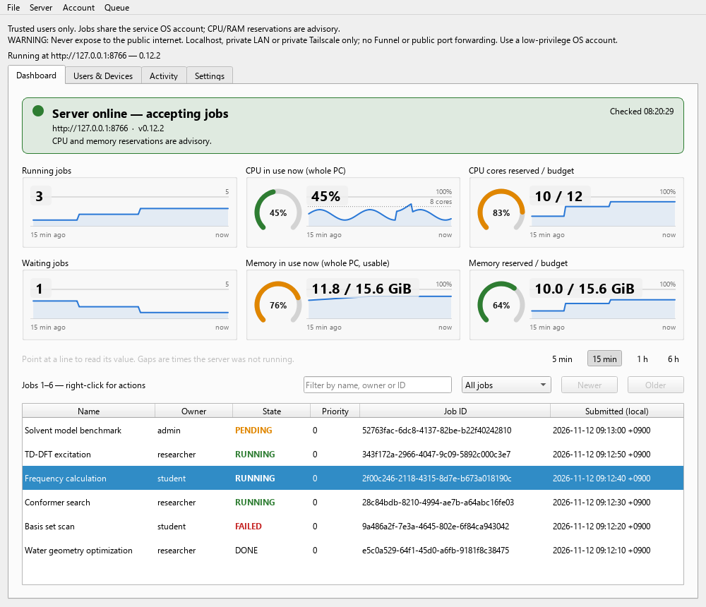
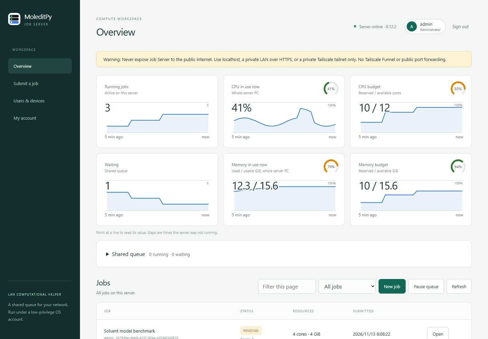
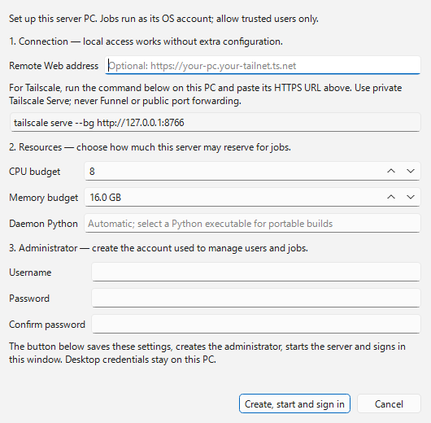
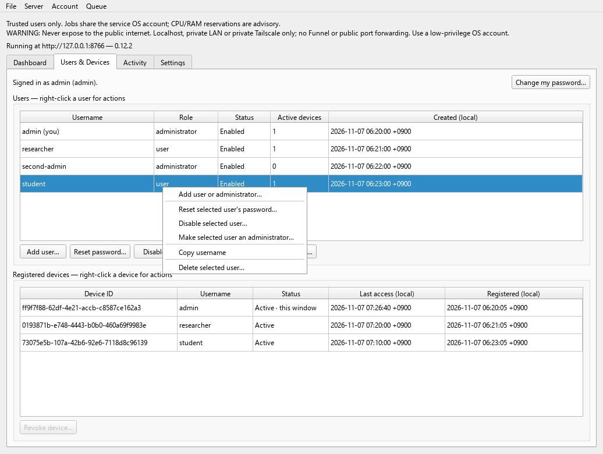
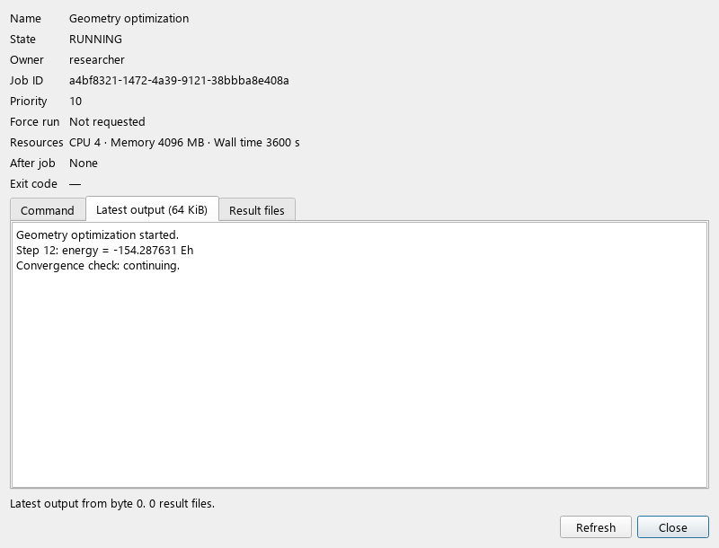
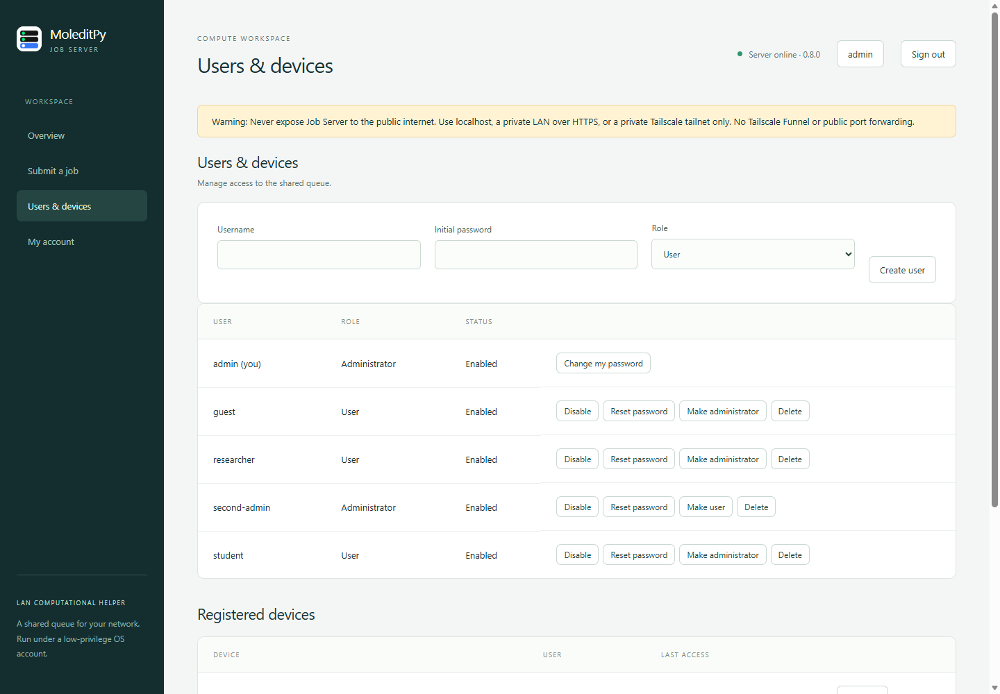
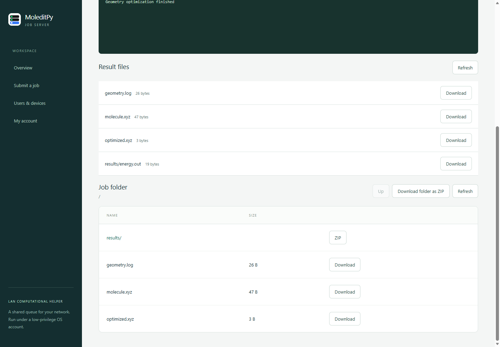

# MoleditPy Job Server

[](https://github.com/HiroYokoyama/moleditpy_job_server/actions/workflows/test.yml)
[](https://github.com/HiroYokoyama/moleditpy_job_server/actions/workflows/security.yml)
[](https://github.com/HiroYokoyama/moleditpy_job_server/actions/workflows/release.yml)
[](https://github.com/HiroYokoyama/moleditpy_job_server/releases)
[](LICENSE)
[](https://github.com/HiroYokoyama/python_molecular_editor)
[](https://doi.org/10.5281/zenodo.23993235)

A shared job queue for one PC on your network. Trusted users submit calculations from
[Job Manager](https://github.com/HiroYokoyama/moleditpy_job_manager), the browser or
Python, and an administrator runs the server from MoleditPy or the command line.

> **Warning:** **Never expose Job Server to the public internet. Use localhost, a private LAN over HTTPS, or a private Tailscale tailnet only.**
> Do not use Tailscale Funnel, router port forwarding, a public reverse proxy, or an internet tunnel.
> Jobs execute arbitrary commands under the service OS account. Only admit trusted users,
> restrict tailnet access, and run under a low-privilege account. Authentication is not an OS sandbox.





## What it does

- **Queue:** CPU and memory budgets, priorities, dependencies, pause and force run. The
  dashboard shows what is reserved beside what the whole PC is using right now.
- **Durable jobs:** jobs run in detached supervisors and a SQLite ledger tracks them, so
  closing MoleditPy or restarting the daemon does not stop a calculation.
- **Accounts:** users and administrators, device keys, password changes and resets,
  enable, disable and delete, with an activity log. See [Accounts](docs/ACCOUNTS.md).
- **Job folders:** open a job's folder in File Explorer on the server PC, or browse and
  download it from the Web UI or Job Manager. See [Job folders](docs/JOB_FOLDERS.md).
- **Local by default:** no listener starts until you ask, and it binds `127.0.0.1`.
  LAN and Tailscale access are explicit opt-ins.

## Quick start

1. In MoleditPy, install the latest **Job Server ZIP** from
   [Releases](https://github.com/HiroYokoyama/moleditpy_job_server/releases) with the Plugin Installer.
2. Open **Extensions → Job Server…**. If Python libraries are missing, it names them.
3. On first use, the setup guide asks for a resource budget and an administrator, then
   starts the server and signs in this window. A new server's budget starts at this PC's size.
4. To reach it from another PC, follow [Connecting from another PC](docs/LAN_SETUP.md) ([日本語](docs/LAN_SETUP_JP.md)).
5. In [Job Manager](docs/JOB_MANAGER.md), add a Job Server host and choose **Sign in / register device**.



Closing the window does not stop the daemon. **Server → Stop** stops it and preserves
running jobs. A portable MoleditPy build needs a Python selected in **Settings → Daemon Python runtime**.

## Desktop window

Right-click a job, user or device for its actions. The same actions are in the menus.



| Tab | Use it to |
|---|---|
| **Dashboard** | See server state, live CPU and memory, reservations and jobs. Filter jobs, open details, set priority, force run, cancel or open the job folder. |
| **Users & Devices** | Add users or administrators, reset passwords, enable, disable or delete users, switch user and administrator, and revoke devices. Change your own password. |
| **Activity** | Read recent logins, account changes and job events. |
| **Settings** | Set the network, budgets, commands run before each job, the job folder and the runtime. Save, then choose **Server → Restart**. |

Double-click a job to see its command, latest output and result files.



## Web UI

Open **http://127.0.0.1:8766/** on the server PC, or the address you set up for other PCs.
Users can submit jobs, follow output, browse job folders, download files, change their
password and revoke their own devices. Administrators also get queue controls and
**Users & devices**.





Sign-in lasts at most 15 minutes in that tab. Administrator actions need a sign-in
within the last 5 minutes. Browser sign-in registers no device and saves no password.

## Headless server

Python 3.11+, on a low-privilege OS account. Qt and MoleditPy are not needed.

```sh
python -m pip install moleditpy-job-server
moleditpy-job-server init
moleditpy-job-server create-admin
moleditpy-job-server serve
```

| Command | Purpose |
|---|---|
| `init` | Write a configuration, with this PC's size as the budget |
| `create-admin` | Create the first administrator |
| `serve` | Run the server |
| `status` | Ask a running server for its health |
| `reset-password <username>` | Recover a forgotten password on the server PC |

Every command accepts `--config /path/to/settings.json`. Data lives in
`~/.moleditpy/job_server/`. Install `moleditpy-job-server[gui]` for the desktop window.

## Python client

```python
from job_server.client import JobServerClient

client = JobServerClient("https://compute.example.org", "device.key")
# Once per device: client.enroll("alice", initial_password)
job = client.submit(
    {"name": "example", "command": "mycommand {input} > {stem}.out",
     "resources": {"cpus_per_task": 2, "memory_mb": 1024, "walltime_seconds": 3600}},
    {"input.inp": "./input.inp"},
    idempotency_key="b176bbfe-bc31-463e-af17-18a2f0678dbd",
)
status = client.request("GET", f"/jobs/{job['id']}")
client.download(job["id"], "result.out", "./results/result.out")
```

Reuse an idempotency key to retry a submission. Uploads and Python downloads resume and
verify SHA-256. Browser downloads hold the file in memory, so use Python for large results.

## Limits

CPU and memory budgets are **advisory**: they decide when jobs start, not what a job may
use. All jobs share the service OS account, so they are not isolated from each other.
This is a service for trusted users. See [SECURITY.md](SECURITY.md) and
[Execution and limits](docs/EXECUTION.md).

## Documentation

| Topic | Page |
|---|---|
| Users, passwords, devices and recovery | [Accounts](docs/ACCOUNTS.md) |
| Reaching the server from another PC | [Step by step](docs/LAN_SETUP.md) ([日本語](docs/LAN_SETUP_JP.md)), [LAN details](docs/LAN_ACCESS.md), [HTTPS and Tailscale](docs/REMOTE_ACCESS.md) |
| Job Manager | [Integration](docs/JOB_MANAGER.md) |
| Job folder API | [Job folders](docs/JOB_FOLDERS.md) |
| Running Linux programs from Windows | [WSL](docs/WSL.md) |
| Executors, walltime and storage | [Execution and limits](docs/EXECUTION.md) |
| Security | [SECURITY.md](SECURITY.md), [audit](docs/SECURITY_AUDIT.md), [specification audit](docs/SPEC_AUDIT.md) |
| Testing and releases | [Verification](docs/VERIFICATION.md), [test coverage](docs/TESTING.md), [workflows](docs/WORKFLOWS.md) |

## Development

```sh
git clone --recurse-submodules https://github.com/HiroYokoyama/moleditpy_job_server.git
cd moleditpy_job_server
python -m pip install -e ".[test,gui]"
python -m pytest -q -n 4
python -m ruff check job_server scripts tests integration setup.py
python -m build
python scripts/build_plugin.py
```

## License

LGPL-3.0-or-later. See [LICENSE](LICENSE), [COPYING](COPYING) and
[dependency and provenance terms](LICENSING.md). Upstream execution code and third-party
components keep their own terms.
