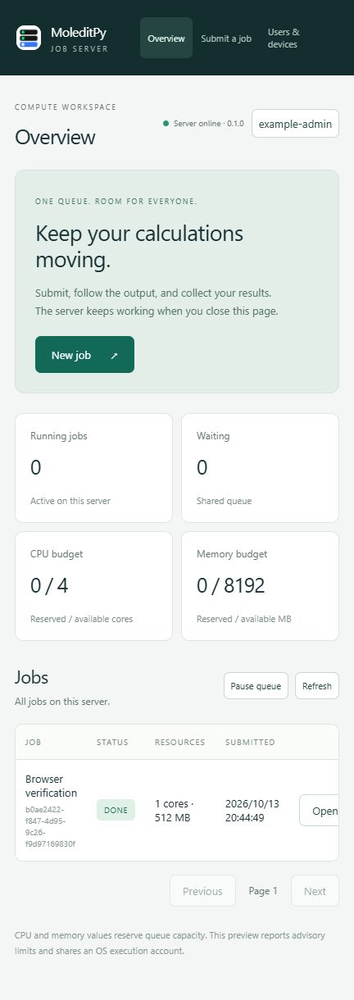

# MoleditPy Job Server

An authenticated shared job queue, headless daemon, MoleditPy administration plugin,
and browser UI for trusted lab members. Version **0.1.0 — Trusted Lab Preview**.



The daemon owns CPU/RAM reservations and a durable SQLite job ledger. Jobs run in
detached supervisors, so closing MoleditPy or stopping/restarting the daemon preserves
running calculations. Native Bash and PowerShell wrappers come from an immutable
Job Manager source dependency, rather than a second maintained copy.

## Install and start

Python 3.11+; use a low-privilege OS account.

```sh
git clone --recurse-submodules https://github.com/HiroYokoyama/moleditpy_job_server.git
cd moleditpy_job_server
python -m pip install ".[gui]"
python -m job_server init
python -m job_server create-admin
python -m job_server serve
```

Open **http://127.0.0.1:8766/** on the same machine. Sign in with the administrator
you created. The browser registers an Ed25519 device key; subsequent sign-ins need
only the username in that browser. Private keys are non-exportable Web Crypto keys
in IndexedDB. Bearer tokens stay in page memory. Clearing browser storage requires
registering a new device and revoking the old one.

CLI commands accept `--config /path/to/settings.json` before or after the command.
Persistent data defaults to `~/.moleditpy/job_server/`, outside installed plugin code.
The listener starts only on explicit `serve` or GUI Start and binds **127.0.0.1**.

### MoleditPy plugin

```sh
python scripts/build_plugin.py
```

Install `dist/job_server_0.1.0.zip` using MoleditPy's Plugin Installer. Open
**Plugin → Job Server → Server Dashboard…**. The GUI can bootstrap the first
administrator, start/stop/restart the daemon, pause/resume the queue, manage accounts
and device keys, and cancel jobs. Reloading or closing the plugin does not stop the daemon.
For a frozen/portable MoleditPy application, install the server in a Python environment
and set `python_executable` in settings to that environment's interpreter.

### Job Manager integration

```sh
python scripts/build_job_manager.py
```

Install the companion `dist/job_manager_job_server_preview.zip` alongside Job Server.
It adds **Job Server (HTTPS)** to Hosts and connects existing submit, monitor, tail,
cancel, and download flows to `JobServerBackend`. Configure the server URL, register
a device, and choose the native scheduler matching the server's execution OS.
The installer replaces Job Manager's code, while its normal data directory is retained.

The companion is generated from the audited upstream commit and an explicit integration
overlay. It does not change your sibling Job Manager repository or its upstream branch.
`integration/job_manager.patch` records changes for upstream review;
`integration/server_backend.py` is the additional bridge module.

### HTTPS on a LAN or Tailscale

Set `public_url` in settings to the exact HTTPS origin, e.g. `https://compute.example.org`.
This allows that browser origin; other origins are rejected. Terminate TLS in a proxy
on the same machine. The daemon ignores forwarded headers and stays on loopback.

```sh
tailscale serve --bg http://127.0.0.1:8766
```

Use the HTTPS URL shown by Tailscale Serve as `public_url`, then restart the daemon.
For a LAN proxy, use a certificate trusted by clients and forward to loopback.
Python clients validate TLS and refuse redirects; custom trust uses a CA file.
Funnel and direct public-internet deployments are outside this preview.

## Python client

```python
from job_server.client import JobServerClient

client = JobServerClient("https://compute.example.org", "device.key")
# Once per device: client.enroll("alice", initial_password)
job = client.submit(
    {"name": "example", "command": "mycommand {input} > {stem}.out",
     "resources": {"cpus_per_task": 2, "memory_mb": 1024, "walltime_seconds": 3600}},
    {"input.inp": "./input.inp"},
    idempotency_key="b176bbfe-bc31-463e-af17-18a2f0678dbd",
)
status = client.request("GET", f"/jobs/{job['id']}")
client.download(job["id"], "result.out", "./results/result.out")
```

Reuse the same idempotency key for retries of a submission. Uploads resume at a
verified contiguous offset. Python downloads resume into `.partial`, verify SHA-256,
and rename on success. Browser downloads verify hashes but buffer the result in memory;
use the Python client for large results. Browser input hashing also uses memory.
Windows client credentials use DPAPI; POSIX credential files require mode 0600.

## Execution and limits

- Linux native and WSL-native daemon: Bash and process groups.
- Windows native: PowerShell `-NoProfile -NonInteractive`, suspended launch into a
  Windows Job Object before execution, process-tree cleanup on cancellation.
- Windows-hosted WSL: configure `executor: "wsl"`, an approved `wsl_distribution`,
  and a `/home/...` `wsl_root`. Upload/commit/work directories live in the distribution
  through its UNC filesystem; commands run through `wsl.exe` and `setsid`.
- CPU/RAM limits are **advisory queue budgets**, not kernel-enforced usage limits.
  Walltime and output storage checks stop offending jobs. The initial storage setting
  limits cumulative declared inputs per user and work-directory size per job.
- Dependencies use server job IDs. Failed dependencies remain visibly BLOCKED unless
  `chain_any` is set. Arbitrary existing directories, force-run, HPC module/directive
  options, and scheduled start times are rejected.
- An ambiguous dispatch claim or missing supervisor is held with `NEEDS_RECHECK`,
  preserving its allocation and never automatically executing it again.
- Privileged administrative operations require device authentication within 5 minutes.
- Automatic deletion is off; data and the idempotency ledger are retained.

This is a trusted-user service. Arbitrary commands have the OS account's permissions:
HTTP ACLs and working directories do not isolate mutually untrusted jobs. See
[SECURITY.md](SECURITY.md) and [the specification audit](docs/SPEC_AUDIT.md).

## Development

```sh
python -m pip install -e ".[test,gui]"
python -m pytest -q
python -m ruff check job_server scripts tests integration setup.py
python scripts/run_regression.py
python -m build
python scripts/build_plugin.py
python scripts/build_job_manager.py
```

CI covers Python 3.11/3.13 on Linux and Windows. Windows-hosted WSL needs a machine
with an installed distribution; its end-to-end acceptance is not claimed by native CI.
See [verification](docs/VERIFICATION.md) for actual results and outstanding platform checks.

GPL-3.0-only. Upstream execution code retains its original license and attribution.
